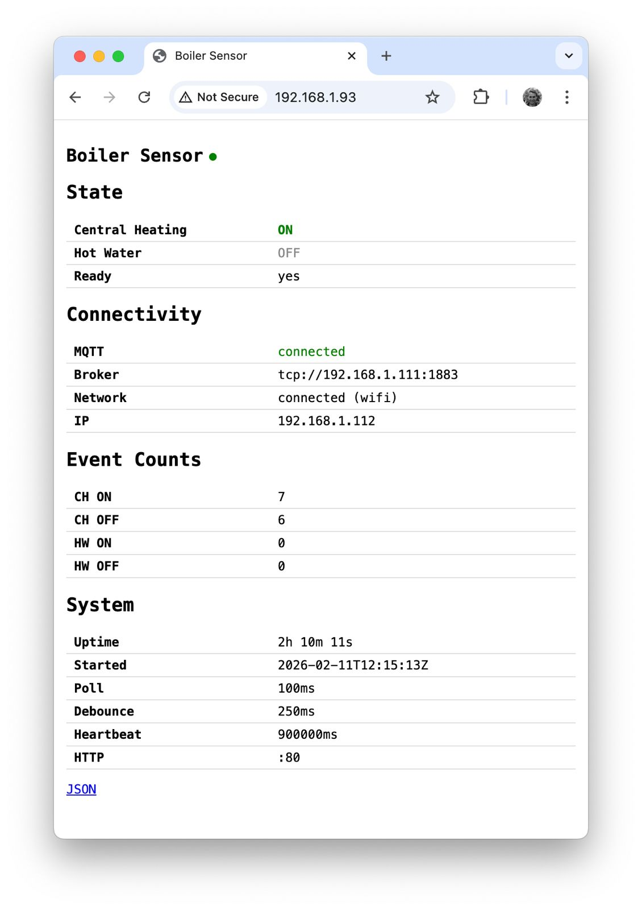

# boiler-sensor

A Go daemon for Raspberry Pi that monitors heating system GPIO inputs and publishes state transitions to MQTT. 

## What It Does

- Monitors two GPIO inputs: Central Heating (BCM 26) and Hot Water (BCM 16)
- Debounces signals to reject electrical noise
- Publishes JSON events to MQTT only on state transitions
- Sends system lifecycle events (startup, shutdown, heartbeat, reconnect)
- Serves a web status page over HTTP
- Runs as a systemd service with graceful shutdown

## Architecture

The sensor engine (debounce, baseline, heartbeat, MQTT plumbing and the daemon
runtime) lives in the shared module
[`github.com/sweeney/common/iot`](https://github.com/sweeney/common/tree/main/iot),
pinned at `iot/v0.1.0`. This repo is the boiler binary on top of it:

```
cmd/boiler-sensor/    # flags, wiring and boilerProfile(): the only place the
                      #   boiler vocabulary (CH/HW, pins, topics) lives
internal/web/         # this service's HTTP status page and /healthz
```

The engine's packages are `iot/logic` (pure debounce logic, no I/O, 100%
covered), `iot/gpio`, `iot/mqtt`, `iot/status` and `iot.Run`. See `REFACTOR.md`
for why the split is shaped this way.

## GPIO

| Signal          | Default BCM Pin | Logic                        |
|-----------------|-----------------|------------------------------|
| Central Heating | 26              | Raw HIGH = OFF, raw LOW = ON |
| Hot Water       | 16              | Raw HIGH = OFF, raw LOW = ON |

Pin numbers are configurable via `--pin-ch` and `--pin-hw` flags.

### Why the Inverted Logic?

The optocoupler modules have inverted output: when heating is ON, current flows through the LED, the phototransistor conducts, pulling the output LOW. When heating is OFF, no current flows and the pull-up resistor holds the output HIGH.

The inversion is applied in exactly one place, `iot/gpio`, for each channel
whose profile sets `ActiveLow: true` (both do, in `boilerProfile()`). Everything
else works with logical states where `true` = ON. For conventional modules
(HIGH = ON), set `ActiveLow: false`.

## MQTT

### Event Topic: `energy/boiler/sensor/events`

Published on each state transition (QoS 0, not retained):

```json
{
  "boiler": {
    "timestamp": "2026-02-10T12:59:22Z",
    "event": "CH_ON",
    "ch": { "state": "ON" },
    "hw": { "state": "OFF" }
  }
}
```

Events: `CH_ON`, `CH_OFF`, `HW_ON`, `HW_OFF`

### System Topic: `energy/boiler/sensor/system`

Published for lifecycle events (QoS 1). Startup, shutdown, and heartbeat events include a full status snapshot:

```json
{
  "status": {
    "event": "STARTUP",
    "ch": "OFF",
    "hw": "OFF",
    "ready": false,
    "uptime_seconds": 0,
    "start_time": "2026-02-10T14:37:58Z",
    "timestamp": "2026-02-10T14:37:58Z",
    "mqtt": { "connected": false, "broker": "tcp://192.168.1.200:1883" },
    "event_counts": { "ch_on": 0, "ch_off": 0, "hw_on": 0, "hw_off": 0 },
    "config": { "poll_ms": 100, "debounce_ms": 250, "heartbeat_ms": 900000 }
  }
}
```

Simple events (LWT disconnect, reconnect) use a compact format:

```json
{ "system": { "timestamp": "2026-02-10T14:30:00Z", "event": "RECONNECTED" } }
```

The MQTT Last Will and Testament (LWT) is set to publish a `SHUTDOWN` event with reason `MQTT_DISCONNECT` if the connection drops unexpectedly.

## Web Status



The daemon serves a lightweight status page over HTTP (default port 80):

- `GET /` or `GET /index.html` — HTML status page with channel states, MQTT connectivity, event counts, uptime, and config
- `GET /index.json` — JSON status response for programmatic access
- `GET /healthz` — health for monitors and the deploy script: `status`
  (`ok`, `starting` before the GPIO baseline, or `degraded` while MQTT is
  disconnected), `version` (the commit), uptime, channel states, and memory
  and goroutine counts. Always HTTP 200; read `status`.

```bash
curl http://pi0wh/              # HTML page
curl http://pi0wh/index.json    # JSON response
curl http://pi0wh/healthz       # health
```

Disable with `--http ""`.

## Configuration

| Flag            | Default                  | Description                          |
|-----------------|--------------------------|--------------------------------------|
| `--poll`        | 100ms                    | GPIO polling interval                |
| `--debounce`    | 250ms                    | Debounce duration                    |
| `--broker`      | tcp://192.168.1.200:1883 | MQTT broker address                  |
| `--pin-ch`      | 26                       | BCM pin for Central Heating          |
| `--pin-hw`      | 16                       | BCM pin for Hot Water                |
| `--heartbeat`   | 15m                      | Heartbeat interval (0 to disable)    |
| `--http`        | :80                      | HTTP status address (empty disables) |
| `--print-state` | false                    | Print current GPIO state and exit    |

## Testing

### Philosophy

The project is designed so that **all tests run without hardware** — no GPIO pins, no MQTT broker, no network. This is achieved through strict dependency injection: every external dependency (GPIO reads, MQTT publishing, time) is abstracted behind an interface with both a real and a fake implementation.

The architecture enforces a hard rule: `internal/logic` must have **zero imports** from I/O packages. It receives logical states and timestamps as plain values and returns domain events. This makes the core business logic trivially testable and means the debounce state machine can be exercised with thousands of synthetic inputs without touching hardware.

### Test Layers

The engine's own suite (debounce state machine at 100% coverage, fuzz test,
GPIO/MQTT fakes, ring buffer, status tracker, runtime lifecycle) lives with the
engine in `sweeney/common/iot`. This repo tests what is boiler-specific:

- **Wire contract (`cmd/boiler-sensor/wire_contract_test.go`)** — the exact MQTT
  bytes the boiler profile produces. Any diff is a regression.
- **Lifecycle golden (`cmd/boiler-sensor/lifecycle_golden_test.go`)** — drives
  `iot.Run` with the real `boilerProfile()` through startup, baseline, single and
  simultaneous transitions, a scheduled heartbeat and SIGTERM, and pins every
  payload, topic and retain flag to what the pre-refactor build published.
- **Profile and flags (`cmd/boiler-sensor/main_test.go`)**.
- **Status page and `/healthz` (`internal/web`)**.
- **Deploy script (`deploy_test.sh`)** — runs `deploy.sh` against stubs: the
  happy path, refusals, and rollback on each kind of failed verification.

### Running Tests

```bash
go test ./...                    # Run all tests
go test -race ./...              # With race detector
go test -cover ./...             # With coverage summary
./deploy_test.sh                 # deploy script tests
```

### CI

GitHub Actions runs on every push to `main` and on pull requests:

1. **Test job** — `go vet`, tests with race detection, the wire-contract golden, per-package coverage reporting (the 100% gate on `logic` runs in `sweeney/common`)
2. **Build job** — cross-compiles for linux/amd64, linux/arm (Pi Zero), and linux/arm64

## Deployment

```bash
./deploy.sh --check      # read-only: every pre-flight check, changes nothing
./deploy.sh              # deploy to sweeney@pi0wh, asking before changing anything
./deploy.sh --yes        # without asking
./deploy.sh --rollback   # back to the build that ran before the last deploy
./deploy.sh --check --rollback   # read-only: what --rollback would do
./deploy.sh user@host    # a different Pi
```

A deploy:

1. **Checks, read-only:** a clean commit that is pushed (the build is stamped
   with the commit, so its hash must be final), `go vet` and `go test`, the Pi
   reachable with passwordless sudo, the service and symlinks as expected, the
   running build healthy, and the broker's retained heartbeat readable.
2. **Builds** for the Pi's architecture with `-X main.version=<commit>`.
3. **Uploads** as `boiler-sensor-<timestamp>-<commit>`, checks the sha256, then
   switches the `boiler-sensor-arm` symlink and restarts. The build it replaced
   is recorded in `~/boiler-sensor/.previous`, and its unit file kept as
   `.previous.service` so a rollback restores both.
4. **Verifies:** `/healthz` reports the new version with status `ok`, it stays
   up, the journal has no fatal error, and the broker holds a `HEARTBEAT` from
   the new run (what statehouse sees).
5. **Rolls back on its own** if any of that fails, and checks the old build is
   healthy again. Exit 1 means it rolled back; 3 means the rollback also failed.

It keeps the three newest builds on the Pi. `./deploy_test.sh` tests the script.

### First-Time Pi Setup

`deploy.sh` expects a Pi that is already set up, and refuses otherwise. On a
fresh Pi, after copying a build and `boiler-sensor.service` into
`~/boiler-sensor/` and pointing `~/boiler-sensor/boiler-sensor-arm` at the build:
link `/usr/local/bin/boiler-sensor` to that symlink and
`/etc/systemd/system/boiler-sensor.service` to the unit file, add the user to
the `gpio` group, then `systemctl daemon-reload` and `systemctl enable
boiler-sensor`.

**Prerequisites:**
- Go 1.21+ on the dev machine
- SSH access to the Pi
- Raspberry Pi OS Lite (32-bit), hostname and WiFi configured via Raspberry Pi Imager

### File Locations on the Pi

| What            | Location                                   |
|-----------------|--------------------------------------------|
| Binary          | `~/boiler-sensor/boiler-sensor-<timestamp>-<commit>`|
| Rollback target | `~/boiler-sensor/.previous`                |
| Its unit file   | `~/boiler-sensor/.previous.service`        |
| Active symlink  | `~/boiler-sensor/boiler-sensor-arm`        |
| System symlink  | `/usr/local/bin/boiler-sensor`             |
| Service file    | `~/boiler-sensor/boiler-sensor.service`    |
| Service symlink | `/etc/systemd/system/boiler-sensor.service`|
| Logs            | `journalctl -u boiler-sensor`              |

### Troubleshooting

**Service won't start:**
```bash
sudo journalctl -u boiler-sensor -n 50 --no-pager
```

**GPIO permission denied:**
```bash
groups  # check gpio group membership — reboot after first deploy if just added
```

**MQTT connection failed:**
```bash
nc -zv 192.168.1.200 1883   # check broker reachability
```

**Read current GPIO state without the daemon:**
```bash
boiler-sensor --print-state
```

## Implementation Notes

This project was built using [Claude Code](https://claude.ai/code) (Anthropic Claude).

| Metric               | Value  |
|----------------------|--------|
| Production code      | ~1,575 lines |
| Test code            | ~3,880 lines |
| Test:Production ratio| 2.5:1  |

## License

MIT
